<div align="center">




</div>


```text
dre_amy@huaraz:~$ whoami
dre_amy

dre_amy@huaraz:~$ cat rol.txt
Estudiante de Ingeniería de Sistemas e Informática (6to ciclo, UNASAM)
Desarrollo Web & UI/UX · Bases de Datos · Tecnología Cívica

dre_amy@huaraz:~$ cat mision.txt
Integrar tecnología, diseño y análisis de datos
para construir soluciones que generen un impacto real.

dre_amy@huaraz:~$ ls ./proyectos
senda/  level-up/  portafolio/  turismo-accesible/
```

Me conoces como Dre_Amy. Estudio Ingeniería de Sistemas e Informática en la UNASAM y me apasiona integrar tecnología, diseño y análisis de datos para construir soluciones que generen un impacto real.

Más allá de las aulas, construyo mi camino en bootcamps, retos de innovación y programas de liderazgo como el Impact Regional Fellowship y STEMos Unidas.


## ✦ Datos personales

| | |
| :-- | :-- |
| **Nombre** | Amy Peralta Aranda |
| **Alias** | Dre_Amy |
| **Ubicación** | Huaraz, Áncash, Perú |
| **Enfoque** | Desarrollo Web & UI/UX · Bases de Datos (SQL) · Tecnología Cívica |
| **Estudios** | Ingeniería de Sistemas e Informática, UNASAM |
| **Comunidad** | Women in STEM |


## ✦ Travesía académica



**Universidad Nacional Santiago Antúnez de Mayolo (UNASAM)** · Ingeniería de Sistemas e Informática · **6to ciclo** · desde abr. 2023

Mi camino por la carrera se ve en lo que voy construyendo:

- **Desarrollo de software:** lenguajes orientados a objetos, web y bases de datos para resolver problemas reales en la región.
- **Bases de datos:** Curso de SQL Server Nivel Intermedio (UNASAM, 2025), SQL Server y PostgreSQL.
- **Web y UI/UX:** React, Vue.js, TypeScript y diseño de interfaces en proyectos como SENDA y Level Up.
- **Innovación y emprendimiento:** bootcamps, hackathons y el Impact Regional Fellowship.
- **Impacto y datos:** Impact Analyst en el Proyecto Quipus (SpinOut / OpenAI).


## ✦ Reconocimientos




## ✦ Programas y liderazgo

| Programa | Rol | Organiza | Periodo |
| :-- | :-- | :-- | :-- |
| **Impact Regional Fellowship 2026**<br><sub>120 horas de formación en innovación, emprendimiento y tecnologías emergentes</sub> | Fellow, representante de Áncash | SpinOut | jul. – sept. 2026 |
| **STEMos Unidas, 2da cohorte**<br><sub>Programa de desarrollo de habilidades STEM y redes de contacto</sub> | Participante | Yachaq Warmi – Mujeres en STEM | ago. – sept. 2026 |
| **Laboratorio de Emprendimientos 2026** | Participante | equipu | 2026 |


## ✦ Proyectos destacados

### 🐾 [SENDA](https://lnkd.in/dRfgNHmN)

Aplicación web cívica para visualizar riesgos de desastres naturales (sismos e inundaciones) y rutas de evacuación. Usa mapas oficiales de riesgo y tiene a Alertín, una mascotita que le pone cara amable a un tema serio. 3er lugar nacional en el Impact Regional Fellowship 2026.

`React` · `TypeScript` · `FastAPI` · `Mapas oficiales de riesgo`

### 🚀 Level Up UNASAM

Plataforma que centraliza convocatorias, eventos y beneficios universitarios para reducir la fricción de buscar información dispersa. Incluyó validación del problema, identidad visual (branding y UI) y estrategia de producto. 1er puesto en el Bootcamp de Innovación y Emprendimiento UNASAM 2026.

`UX/UI` · `Branding` · `Prototipado rápido` · `Innovación digital`

### 🌐 Portafolio Profesional

Portafolio interactivo en evolución que integra SIGE (Sistema Integral de Gestión Eclesiástica) y dmcookies (dashboard de analítica de privacidad y cookies), junto con un sistema estructurado de habilidades técnicas.

`Vue.js` · `Firebase` · `JavaScript` · `Supabase` · `React`

### ♿ Propuesta de Turismo Accesible

Iniciativa para democratizar el turismo, presentada en el Banco de Ideas MINCETUR, Hackathon "Sin Barreras". Superó múltiples fases y llegó a la penúltima etapa a nivel nacional.

`Accesibilidad web` · `Diseño UX/UI` · `Inteligencia Artificial` · `Prototipado rápido`


### 📊 Inteligencia de Negocios y Bases de Datos

Manejo avanzado de SQL Server y PostgreSQL, con reportes en Power BI sobre más de 1,000 registros.

`SQL Server` · `PostgreSQL` · `Power BI`


## ✦ En mi GitHub

| Repositorio | Qué es | Stack |
| :-- | :-- | :-- |
| [**dmcookies-dashboard**](https://github.com/amyjimenaperaltaaranda-cyber/dmcookies-dashboard) | Dashboard de analítica de privacidad y cookies. | `JavaScript` |
| [**Iglesia-web-Demo**](https://github.com/amyjimenaperaltaaranda-cyber/Iglesia-web-Demo) | Copia de portafolio de un sistema de gestión e inventario para una iglesia, sin bases de datos de producción, historiales ni credenciales, con datos de prueba. | `Vue.js` · `Firebase` |
| [**CASA-PERALTA**](https://github.com/amyjimenaperaltaaranda-cyber/CASA-PERALTA) | Inventario y gestión del hogar desde el celular. | `TypeScript` |
| [**ALBUM-AMY**](https://github.com/amyjimenaperaltaaranda-cyber/ALBUM-AMY) | Réplica pixel perfect de un diseño a partir de una captura de pantalla. | `TypeScript` · `Vite` |


## ✦ Habilidades



<details>
<summary>Ver como lista</summary>

- **Backend & APIs:** Python, FastAPI, Programación orientada a objetos
- **Bases de datos & BI:** SQL, SQL Server, PostgreSQL, Power BI, Bases de datos relacionales
- **Frontend & Web:** React, Vue.js, TypeScript, JavaScript, Vite, Accesibilidad web
- **Infraestructura & flujo:** Docker, Git, Firebase, Supabase
- **Diseño & producto:** Diseño UX/UI, Figma, Prototipado rápido, Branding, Adobe Lightroom
- **Innovación & emprendimiento:** Validación de problemas, Pitch, Gestión de proyectos, Innovación digital, Tecnologías emergentes, Inteligencia Artificial
- **Datos & impacto:** Procesamiento de datos, Estructuración histórica, Análisis de impacto
- **Liderazgo & comunidad:** Liderazgo, Trabajo en equipo, Networking, Compromiso ciudadano, Impacto social, Sostenibilidad

</details>


## ✦ Certificaciones

| Certificación | Organiza | Fecha |
| :-- | :-- | :-- |
| [Impact Regional Fellowship 2026](https://irf.spinoutworld.org/fellows?codigo=IRF26-ANCASH-001) | SpinOut | oct. 2026 |
| [Réplica de CADE Universitario 2026: "La Democracia es Clave"](https://aplicaciones.ipae.pe/certificados/certificados_rep_cuni_huaraz_021126.php?cdg=Ay981) | IPAE | oct. 2026 |
| Programa de Talleres Ambientales "Tunitas Rojas" | Tunitas Perú | oct. 2026 |
| Programa STEMos Unidas, 2da cohorte | Yachaq Warmi – Mujeres en STEM | sept. 2026 |
| Productividad Inteligente: Del caos al orden con Gemini | Bridges of Equity | sept. 2026 |
| [Curso SQL Server Nivel Intermedio](https://sites.google.com/view/coespeancash/inicio) | UNASAM | oct. 2025 |


## ✦ Hablemos

<div align="center">

[](https://github.com/amyjimenaperaltaaranda-cyber)
[](https://www.linkedin.com/in/amy-peralta-aranda-31a766413/)
[](https://www.instagram.com/dre__amy/)
[](mailto:amyjimenaperaltaaranda@gmail.com)

<br>

✦ &nbsp; *Sistemas, datos y código, con alma creativa.* &nbsp; ✦

</div>
